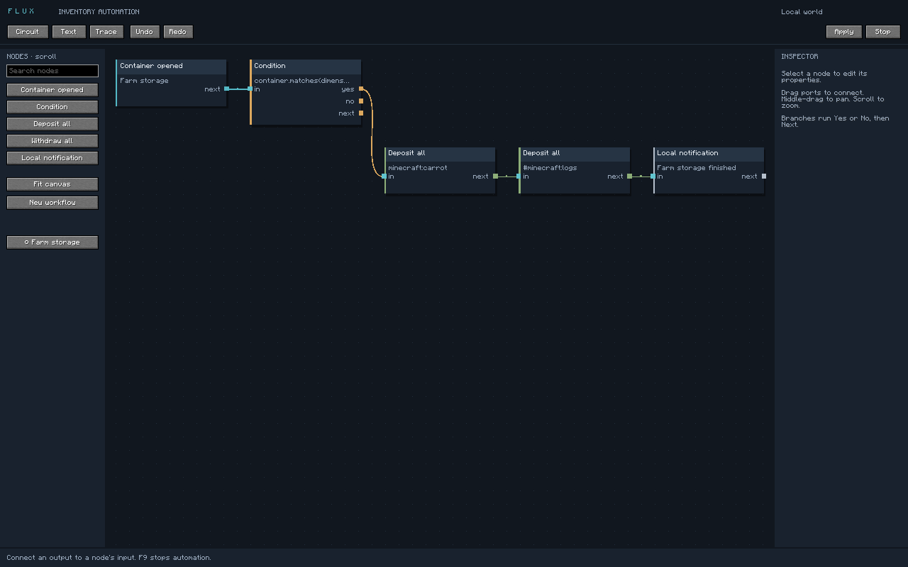

# Verification — 2026-09-11

## Build and automated checks

`./gradlew build runClientGameTest --no-daemon` passed using Java 25.0.4.1 on an Apple M2 MacBook Air, macOS arm64, Minecraft 26.2, Fabric Loader 0.19.5, Fabric API 0.160.0+26.2, and Loom 1.17.20.

The release artifact is `build/libs/flux-1.0.0.jar`. Inspection confirmed that it includes the client entrypoint and excludes all game-test fixtures and packet-delay mixins. The separate sources jar is also built.

**28 unit tests passed**, with zero failures/errors/skips. Coverage includes:

- Lexer/parser diagnostics, version rejection, escape handling, numeric grammar, identifiers, item/tag resolution, boolean precedence, and duplicate workflow names.
- Canonical text/graph round-tripping, comments, deeply parenthesized boolean expressions, layout preservation, 600-action graph traversal, global instruction bounds, cycles, invalid ports, shared inputs, detached nodes, and undo/redo of invalid drafts.
- Source/draft separation, atomic replacement, last-good backups despite externally corrupted source, malformed metadata, profile isolation, and canvas position restoration.
- Transfer confirmations versus local prediction, unrelated updates, duplicate/stale state IDs, state-ID wraparound, timeouts without retry, partial/no-op/full/empty outcomes, tags, reverse transfers, click intervals, dimension/location matching, source changes, inflow limits, cancellation, transition budgets, and deadlines.

## Real client/integrated-server tests

The Fabric client game test creates its own disposable world and configuration directory. It passed all of these assertions:

- A chest received **76 carrots** from the main inventory and hotbar and **32 oak logs** selected by tag. Seven unmatched diamonds stayed in the player inventory. Counts were checked on the actual server, not inferred from the UI.
- Trapped chests, barrels, shulker boxes, and ender chests each received 16 carrots with **eight client ticks of added inbound slot-update latency**.
- A double chest captured both positions and deposited eight carrots when the workflow matched the opposite half.
- An actual manual container input immediately cancelled a workflow waiting on a delayed confirmation.
- Reopening with a nonmatching coordinate produced a false condition and no transfer action.
- Circuit, inspector, text, and trace screens rendered. The text editor was asserted visible with the applied source. Circuit→Text→Circuit and graphical Undo were exercised. Screenshots cover 854×480 and 1280×800 test windows.

Other captures: [inspector](screenshots/inspector.png), [text](screenshots/text.png), [trace](screenshots/trace.png), [small viewport](screenshots/circuit-small.png).

## Performance evidence

The last complete game test recorded **51 active ticks**, with a **0.132 ms mean** and **2.939 ms maximum** for `WorkflowRuntime.tick()` on the machine above. The trace and raw timing summary are preserved in [verification-trace.txt](verification-trace.txt). Earlier runs also had cold maxima above 1 ms.

These measurements include instruction evaluation and normal game quick-move calls, but exclude editor rendering, general networking, and world rendering. Delayed-wait ticks are included in the average. This is a small correctness workload, not a sustained benchmark. The proposed **under-1-ms maximum per active tick is not yet met**. Idle code paths make no inventory scans by construction; no CPU percentage or allocation claim is implied.

## Remaining verification

- No unmodified dedicated-server or public-server session was run. The integrated-server tests exercise real vanilla menu handling and packet serialization, but do not prove compatibility with server plugins, proxies, or anti-cheat systems.
- Partial/full containers, rejected/no-op clicks, occupied cursors, and hard timeouts have unit coverage; their full in-game matrix remains to be exercised.
- The editor's complete drag/keyboard/resize/long-workflow interaction matrix has not been exhaustively tested. Small GUI scales use scrolling sidebars and hide text in very small graph overviews; lower GUI scale provides a more usable editing workspace.
- GitHub Actions now includes client game tests under Xvfb, but the remote CI job has not been run from this workspace.
